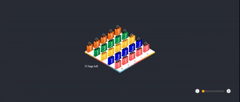

# 🛸 Fukuburu Bags Clone

An isometric "lucky bag" (福袋 *fukubukuro*) shop UI built with React. Pick a bag, and a spaceship flies in, beams it up, and abducts it, leaving one less bag on the board.





## ✨ Features

- **Isometric 5×5 board**: 5 colors × 5 sizes (XS → XL), each color on its own row
- **Spaceship abduction**: click a bag → the ship flies above it, emits a light beam, takes the bag and flies away
- **Live stock counter**: "21 bags left" updates as bags get claimed
- **Computed positions**: every bag and the ship target are calculated from color + size, nothing hard-coded
- **Backend-ready data layer**: mocked with a `const` array, swappable for a real `fetch`

## 🧱 Tech Stack

- React
- CSS (absolute positioning + transforms + animations)
- Image assets for the board and the bags

## 🗂 Project Structure

```
src/
├── _mocks/
│   └── _bags.js        # Mock data
├── api/
│   └── bags.js         # fetchBags()
├── components/
│   ├── Fukuburu-bags   # Main scene: board, bags, counter
│   ├── Bag-item        # Single bag (absolutely positioned)
│   ├── Zomable-content # Zoom in + zoom out toptions          
│   └── Spaceship       # Ship + beam, driven by phase
├── hooks/
│   └── useAbduction.js    # Phases: idle → beaming → leaving
├── images/                # Board and bag images
└── shared/                # Shared sytles (css varibales and global classes)
```

## 🚀 Getting Started

```bash
git clone https://github.com/zahrakaabi/fukuburu_clone.git
cd fukuburu-bags
npm install
npm run dev
```

## 🎮 How It Works

1. `fetchBags()` loads the bags (color, size, `claimed`).
2. `getBagPosition(color, size)` converts each bag into isometric `left/top` coordinates.
3. Clicking a bag calls `start()` from `useAbduction`.
4. The hook moves through phases: `idle` → `beaming` → `leaving`.
5. On `onComplete`, the bag is marked as claimed and removed from the board.

## 🛣 Roadmap

- [ ] Connect to a real backend
- [ ] Sound effects for the abduction
- [ ] Mobile / touch polish
- [ ] "Sold out" end state